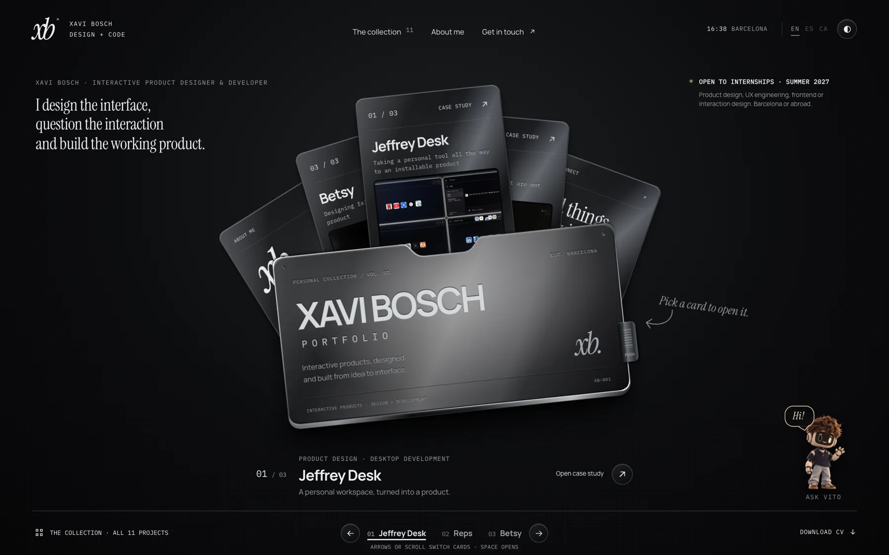

# Portfolio

[boschwebs.website](https://boschwebs.website)

My portfolio as an object you open: a silver cardholder with three case studies, a collection of eleven projects, and Vito, a small assistant that answers questions about my work using only what the site says.



## What is in it

- **Three full case studies** (Jeffrey Desk, Reps, Betsy). Every statement is tagged as known, observed, assumed, tested or not validated, so it is clear what is proven and what is still a guess.
- **The collection.** All eleven projects, grouped by what they are: case studies, smaller builds, prototypes, experiments and coursework.
- **Vito.** A chat that runs on a Vercel function. It retrieves from the site's own text (BM25 over projects, case studies and a short profile) and answers through Groq's free tier, quoting only what is written. A rate limit and an origin check keep it cheap.
- **English, Spanish and Catalan**, switched in place without reloading.
- **Phone, tablet and desktop.** On a phone the case studies become a looping carousel and the chat takes the whole screen.

## Built with

Astro for the build, plain JavaScript, GSAP and CSS 3D. No WebGL, so the engraved text on the metal stays real text: selectable, translatable and readable by a screen reader.

Every view has a real address (`/work/betsy`, `/about`) and is built as its own HTML page, with its own title and link preview, readable without JavaScript. In the browser it stays one document: opening a project moves the address bar and the folio opens over the cardholder, without a page load. Old `#/work/betsy` links still land.

| Path | What it is |
| --- | --- |
| `src/wallet.js` | The cardholder: fan, eject switch, pointer-lit metal |
| `src/main.js` | Routing, the open folio, project cards, gallery and lightbox |
| `src/pages/`, `src/layouts/` | The built pages: one per view, all the same document |
| `src/render.js` | The folio's markup, shared by the build and the browser |
| `src/data/` | Projects and case studies, one file per language |
| `src/i18n.js`, `src/i18n/` | Interface text and project translations |
| `src/vito.js`, `api/chat.js` | The assistant and its endpoint |
| `scripts/check*.mjs` | Browser checks for desktop, phones and addresses (Playwright) |

## Run it

```sh
npm install
npm run dev -- --port 4186
```

The chat needs a `GROQ_API_KEY` in the environment. After editing projects, case studies or `content/bot/profile.md`, run `npm run knowledge` so Vito learns the change.

Checks, with the dev server running (or `PORTFOLIO_URL` pointing at a served build):

```sh
npm run test:browser
npm run test:mobile
npm run test:routes
```

Link-preview images in `public/og/` come from the built site: `npm run og` with it served.
